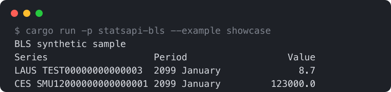

# statsapi

Typed, blocking Rust clients for 26 public statistics sources (BLS, BEA, Census-adjacent federal datasets, World Bank, WHO, SDMX agencies, CDC and other Socrata portals, education, housing, credit, elections and more), so you can pull official numbers without writing a scraper per agency.



The image is the output of `cargo run -p statsapi-bls --example showcase`: the example decodes the crate's own synthetic test fixture (the real upstream layout, invented values) through the public API, offline. Reproduce it with `docs/showcase/make-screenshots.sh` (see [docs/showcase.md](docs/showcase.md)).

## Install

These crates are not on crates.io. Add the one you need as a git dependency:

```toml
[dependencies]
statsapi-bea = { git = "https://github.com/davidawad/statsapi", package = "statsapi-bea" }
```

Pin `rev = "<commit>"` or `tag = "<tag>"` for reproducible builds. Each crate is independent: depend only on the one you need. No crate reads global state; API keys and an optional cache directory are passed by the caller. HTTP is blocking `reqwest` with rustls (no OpenSSL), with jittered retry on 429, 5xx and transport errors.

Build everything: `cargo build --workspace`. The offline tests need no network or keys: `cargo test --workspace`. Live tests are `#[ignore]`d; run them with `cargo test -p <crate> -- --ignored` (keyed sources print `credential_missing` and pass when the key is absent).

## Crates

| Crate | What it covers | Details |
| --- | --- | --- |
| `statsapi-bea` | Reusable blocking Rust client for the U.S. Bureau of Economic Analysis Regional API | [README](crates/statsapi-bea/README.md) |
| `statsapi-bls` | Reusable blocking Rust client for the U.S. Bureau of Labor Statistics public data APIs | [README](crates/statsapi-bls/README.md) |
| `statsapi-cfpb` | Reusable client for CFPB complaint and consumer credit trends data. | [README](crates/statsapi-cfpb/README.md) |
| `statsapi-county-health-rankings` | Reusable client for County Health Rankings & Roadmaps annual data | [README](crates/statsapi-county-health-rankings/README.md) |
| `statsapi-dataverse` | Reusable Rust client for Dataverse dataset and file APIs | [README](crates/statsapi-dataverse/README.md) |
| `statsapi-eviction-lab` | Reusable blocking client for Eviction Lab aggregate data | [README](crates/statsapi-eviction-lab/README.md) |
| `statsapi-fars` | Reusable blocking client for NHTSA FARS annual CSV archives. | [README](crates/statsapi-fars/README.md) |
| `statsapi-gdelt` | Reusable blocking client for GDELT DOC 2.0 timelines | [README](crates/statsapi-gdelt/README.md) |
| `statsapi-hmda` | Reusable Rust client for the FFIEC HMDA Data Browser CSV API. | [README](crates/statsapi-hmda/README.md) |
| `statsapi-household-credit` | Reusable client for public household credit data from the NY Fed, Federal Reserve Board, and Urban Institute | [README](crates/statsapi-household-credit/README.md) |
| `statsapi-hud-user` | Reusable blocking Rust client for the HUD USER FMR, income limits, and USPS crosswalk APIs | [README](crates/statsapi-hud-user/README.md) |
| `statsapi-irs-soi` | Reusable client for IRS Statistics of Income ZIP and migration datasets | [README](crates/statsapi-irs-soi/README.md) |
| `statsapi-meta-sci` | Reusable client for Meta's Social Connectedness Index files on HDX | [README](crates/statsapi-meta-sci/README.md) |
| `statsapi-naep` | Reusable Rust client for the NAEP Data Service API | [README](crates/statsapi-naep/README.md) |
| `statsapi-openfec` | Blocking Rust client for OpenFEC aggregate and committee endpoints | [README](crates/statsapi-openfec/README.md) |
| `statsapi-opportunity-insights` | Blocking client for Opportunity Insights public CSV datasets | [README](crates/statsapi-opportunity-insights/README.md) |
| `statsapi-sdmx` | Reusable blocking SDMX HTTP client and response decoder | [README](crates/statsapi-sdmx/README.md) |
| `statsapi-seda` | Blocking CSV client for Stanford Education Data Archive releases | [README](crates/statsapi-seda/README.md) |
| `statsapi-socrata` | Reusable blocking client for Socrata Open Data API | [README](crates/statsapi-socrata/README.md) |
| `statsapi-urban-education` | Reusable client for the Urban Institute Education Data Portal | [README](crates/statsapi-urban-education/README.md) |
| `statsapi-uscourts-bankruptcy` | Blocking Rust client for U.S. Courts F-5A bankruptcy statistics | [README](crates/statsapi-uscourts-bankruptcy/README.md) |
| `statsapi-usda-food-access` | Reusable client for USDA ERS food access and FNS SNAP data files | [README](crates/statsapi-usda-food-access/README.md) |
| `statsapi-who-gho` | Reusable blocking client for the WHO Global Health Observatory OData API | [README](crates/statsapi-who-gho/README.md) |
| `statsapi-wikimedia-hiringlab` | Reusable blocking client for Wikimedia pageviews and Indeed Hiring Lab job postings | [README](crates/statsapi-wikimedia-hiringlab/README.md) |
| `statsapi-worldbank` | Reusable blocking client for the World Bank Indicators API v2 | [README](crates/statsapi-worldbank/README.md) |
| `statsapi-wvs-pew` | Parsers and weighting for manually downloaded World Values Survey and Pew data files | [README](crates/statsapi-wvs-pew/README.md) |

Every crate README has a usage example (mirrored by `examples/basic.rs`), the endpoints or files it covers, how authentication works, and a terms table (automated access, redistribution, attribution, rate limits) with links to the upstream terms as reviewed. Test fixtures keep each upstream's layout but carry synthesized values, except trimmed US federal public-domain samples.

This project is not affiliated with or endorsed by any of the data providers. Using a client does not change a provider's terms: check them before you redistribute data.

## License

GPL-3.0-or-later; see [LICENSE](LICENSE).
