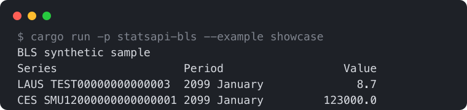

# Showcase

The README image is generated offline: no network, no API keys, no upstream calls. `crates/statsapi-bls/examples/showcase.rs` decodes the crate's synthetic test fixture through its public API and prints a table; the script wraps the text into an SVG terminal frame and renders the PNG.

```sh
docs/showcase/make-screenshots.sh   # needs cargo and rsvg-convert (brew install librsvg)
```



Every crate also has `examples/basic.rs`, which calls the live upstream (network, and a key where its README says so).
