# Showcase

Every image here is generated offline: no network, no API keys, no upstream calls. Each crate's `examples/showcase.rs` decodes that crate's synthetic test fixture (the real upstream layout, invented values) through its public API and prints a small table; the script wraps the text in a terminal frame and renders the PNG.

```sh
docs/showcase/make-screenshots.sh           # both stages
docs/showcase/make-screenshots.sh --text    # run every example (needs cargo)
docs/showcase/make-screenshots.sh --render  # SVG + PNG (needs rsvg-convert: brew install librsvg)
```

Every client also has `examples/basic.rs`, which calls the live upstream (network, and a key where its README says so).

## `statsapi-arcgis`

Reusable blocking client for ArcGIS REST feature services

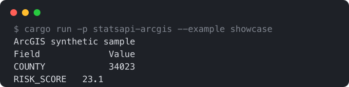

## `statsapi-bea`

Reusable blocking Rust client for the U.S. Bureau of Economic Analysis Regional API


## `statsapi-bis`

Reusable client for the keyless BIS Data Portal SDMX API: credit gaps, total credit, property prices, debt service ratios

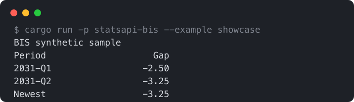

## `statsapi-bls`

Reusable blocking Rust client for the U.S. Bureau of Labor Statistics public data APIs

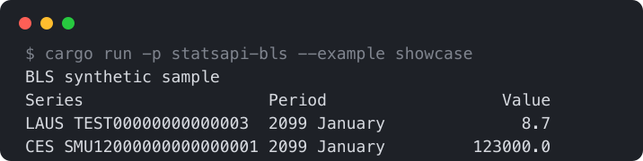

## `statsapi-cdc-wonder`

Reusable blocking client for the CDC WONDER XML API and CDC mortality datasets on data.cdc.gov

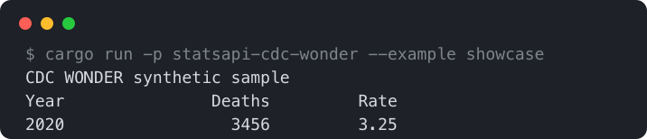

## `statsapi-census`

Reusable client and parsers for Census API and Census Reporter ACS data

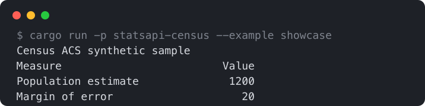

## `statsapi-census-bds`

Reusable blocking Rust client for the U.S. Census Bureau Business Dynamics Statistics (BDS) timeseries API

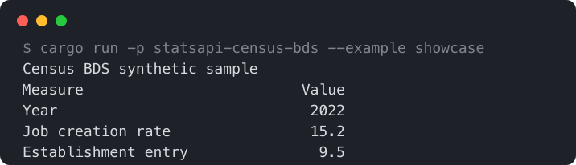

## `statsapi-cfpb`

Reusable client for CFPB complaint and consumer credit trends data.

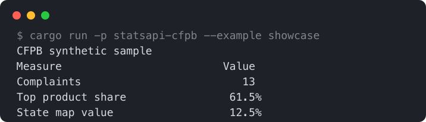

## `statsapi-cisa-kev`

Reusable blocking Rust client for the CISA Known Exploited Vulnerabilities catalog and NVD CVE counts

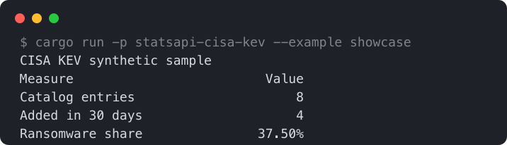

## `statsapi-cms`

Reusable client for the CMS data.cms.gov data-api v1 (Medicare geographic variation, Part D opioid prescribing)

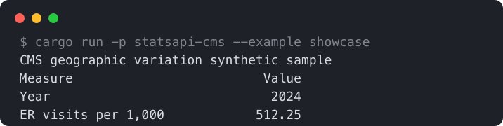

## `statsapi-county-health-rankings`

Reusable client for County Health Rankings & Roadmaps annual data

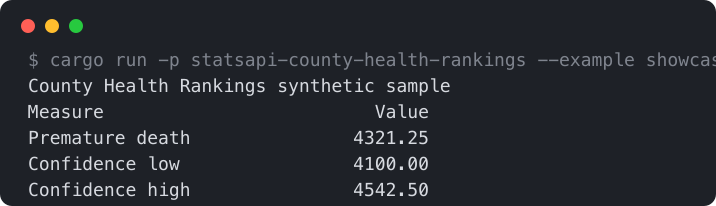

## `statsapi-cow`

Reusable CSV decoder for Correlates of War historical datasets

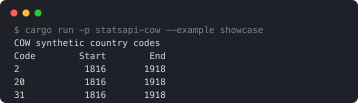

## `statsapi-dataverse`

Reusable Rust client for Dataverse dataset and file APIs

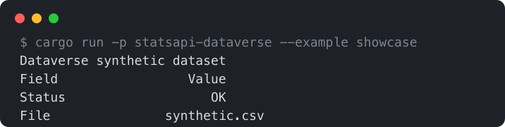

## `statsapi-drought-monitor`

Reusable blocking client for the US Drought Monitor data services

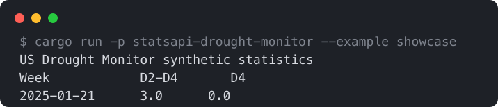

## `statsapi-ember`

Reusable blocking client that streams Ember electricity generation CSV downloads


## `statsapi-envirofacts`

Reusable blocking Rust client for EPA Envirofacts (TRI) and the EPA Superfund NPL ArcGIS layer

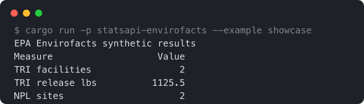

## `statsapi-epa-aqs`

Reusable blocking client for the EPA Air Quality System API

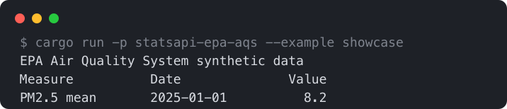

## `statsapi-eurostat`

Reusable blocking client for the Eurostat dissemination API (JSON-stat) and GISCO NUTS boundaries

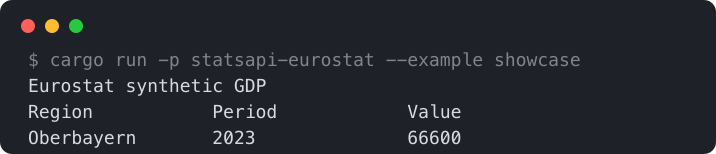

## `statsapi-eviction-lab`

Reusable blocking client for Eviction Lab aggregate data

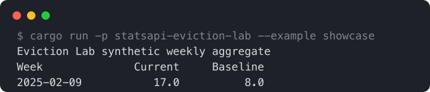

## `statsapi-faostat`

Reusable blocking client that streams FAOSTAT bulk datasets and filters one country in memory

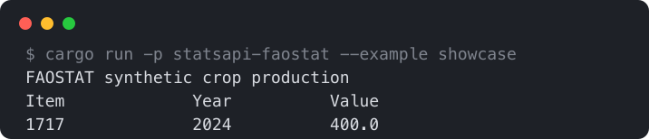

## `statsapi-fars`

Reusable blocking client for NHTSA FARS annual CSV archives.

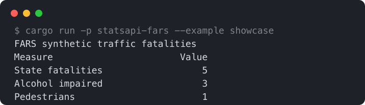

## `statsapi-fbi-cde`

Blocking Rust client for the FBI Crime Data Explorer summarized-offense API

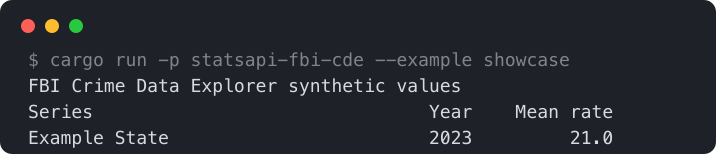

## `statsapi-fcc-bdc`

Reusable blocking client for FCC Broadband Data Collection public files

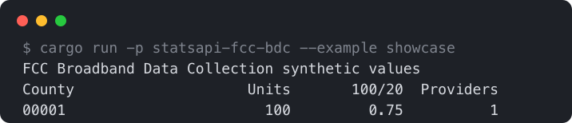

## `statsapi-fema`

Reusable blocking client for OpenFEMA and FEMA public data services

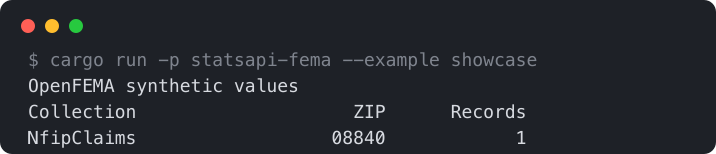

## `statsapi-fhfa`

Reusable streaming client for FHFA annual house price index files by ZIP, county and tract

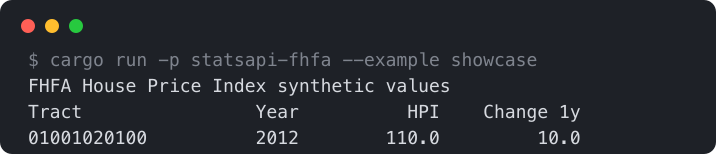

## `statsapi-gdacs`

Reusable blocking client for the GDACS global disaster alert API

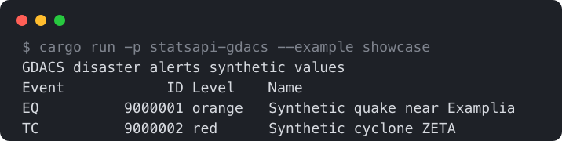

## `statsapi-gdelt`

Reusable blocking client for GDELT DOC 2.0 timelines

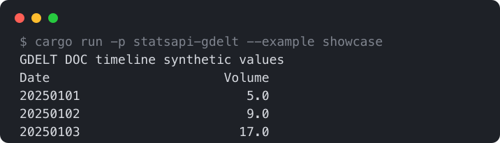

## `statsapi-governance-indices`

Reusable blocking client for the Transparency International CPI and RSF World Press Freedom Index

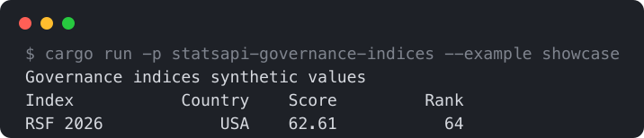

## `statsapi-hmda`

Reusable Rust client for the FFIEC HMDA Data Browser CSV API.

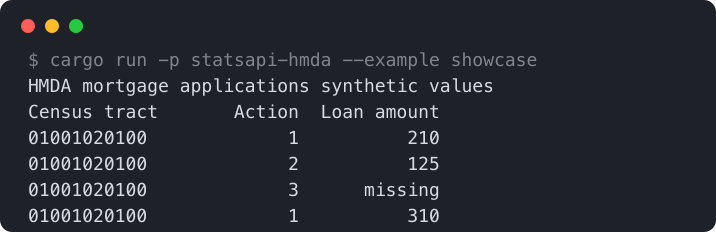

## `statsapi-household-credit`

Reusable client for public household credit data from the NY Fed, Federal Reserve Board, and Urban Institute

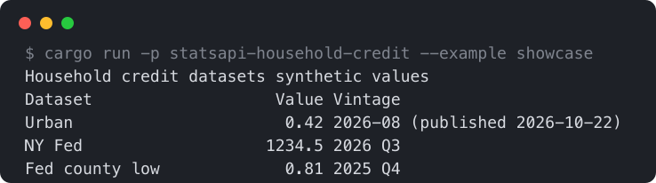

## `statsapi-hud-user`

Reusable blocking Rust client for the HUD USER FMR, income limits, and USPS crosswalk APIs

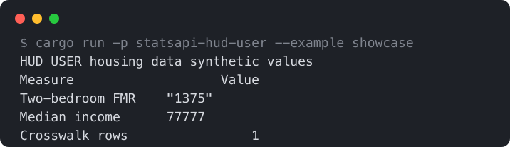

## `statsapi-imf-datamapper`

Reusable blocking client for the IMF DataMapper API (World Economic Outlook series)

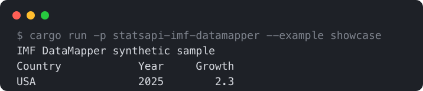

## `statsapi-ioda`

Reusable blocking client for the IODA internet outage API

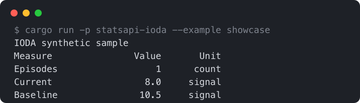

## `statsapi-irs-eo`

Reusable parsers and blocking access helpers for IRS exempt-organization files

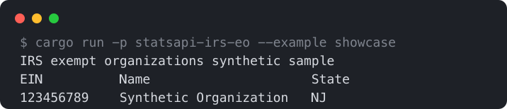

## `statsapi-irs-soi`

Reusable client for IRS Statistics of Income ZIP and migration datasets

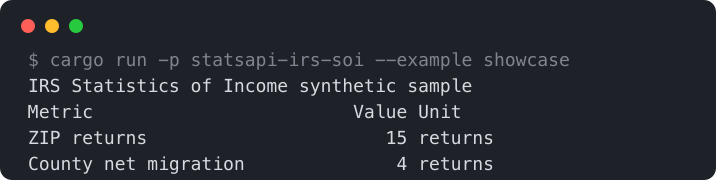

## `statsapi-launch-library`

Reusable blocking client for The Space Devs Launch Library 2 launch counts and upcoming launches

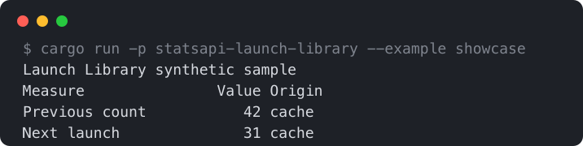

## `statsapi-meta-sci`

Reusable client for Meta's Social Connectedness Index files on HDX

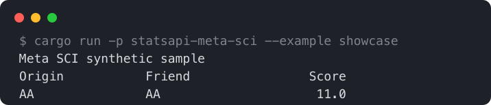

## `statsapi-naep`

Reusable Rust client for the NAEP Data Service API

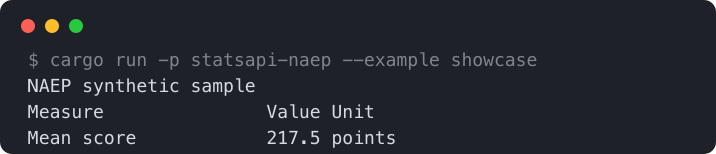

## `statsapi-nara`

Reusable NARA Catalog API v2 client

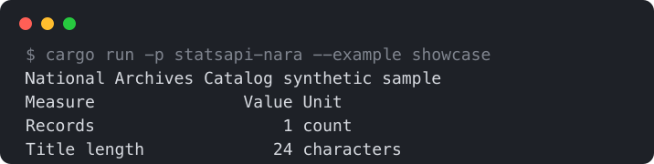

## `statsapi-nasa-power`

Reusable blocking client for the NASA POWER daily point API

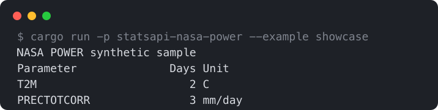

## `statsapi-noaa`

Reusable client for NOAA NCEI Storm Events bulk files


## `statsapi-noaa-cdo`

Reusable blocking client for the NOAA NCEI Access Data Service (GHCN-Daily summaries and 1991-2020 climate normals)

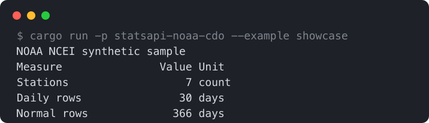

## `statsapi-ons`

Reusable blocking client for the UK Office for National Statistics API and postcodes.io

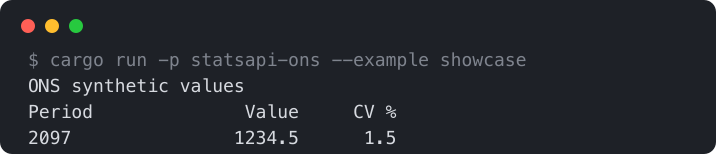

## `statsapi-ookla`

Reusable parser and client helpers for Ookla Open Data performance tiles

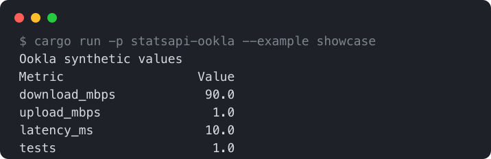

## `statsapi-openaq`

Reusable blocking Rust client for the OpenAQ v3 air quality API

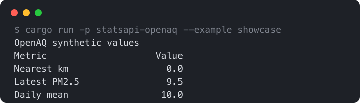

## `statsapi-openfec`

Blocking Rust client for OpenFEC aggregate and committee endpoints

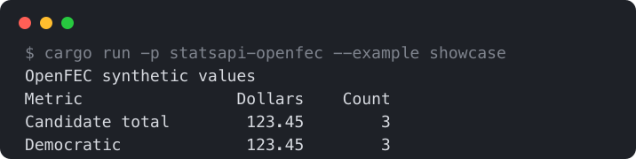

## `statsapi-opensky`

Reusable blocking client for the OpenSky Network live state-vector REST API

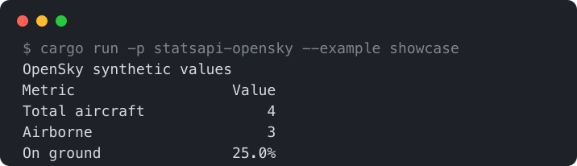

## `statsapi-opportunity-insights`

Blocking client for Opportunity Insights public CSV datasets

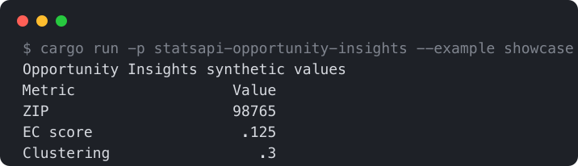

## `statsapi-owid`

Reusable blocking streaming client for Our World in Data grapher CSV endpoints


## `statsapi-power-price`

Reusable client for public U.S. electricity price data

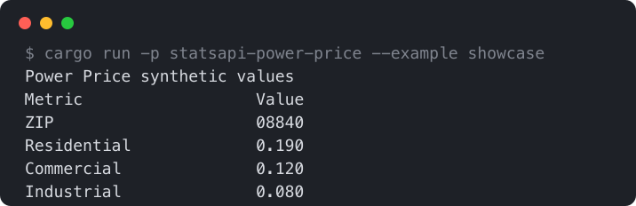

## `statsapi-reliefweb`

Reusable blocking client for the ReliefWeb API v2 disasters and reports endpoints

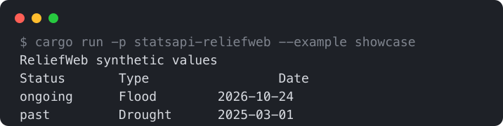

## `statsapi-sanctions`

Reusable streaming client for the OFAC SDN list and the UN Security Council consolidated list

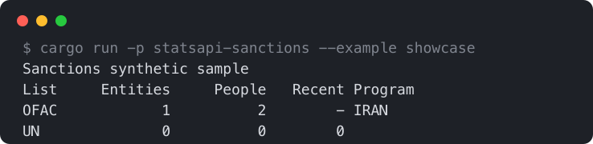

## `statsapi-sba`

Reusable streaming Rust client for the SBA open data 7(a), 504 and PPP loan files.

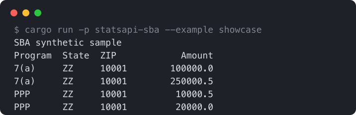

## `statsapi-sdmx`

Reusable blocking SDMX HTTP client and response decoder

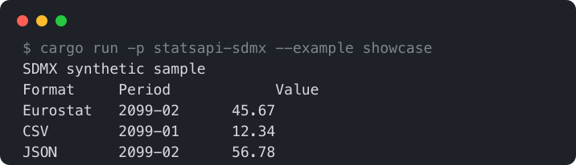

## `statsapi-seda`

Blocking CSV client for Stanford Education Data Archive releases


## `statsapi-senate-lda`

Reusable blocking client for the US Senate Lobbying Disclosure Act (LDA) REST API


## `statsapi-socrata`

Reusable blocking client for Socrata Open Data API


## `statsapi-statcan`

Reusable blocking client for the Statistics Canada Web Data Service (WDS)


## `statsapi-ucdp-history`

Reusable CSV decoder for UCDP/PRIO historical conflict datasets


## `statsapi-un-wpp`

Reusable blocking client that streams UN World Population Prospects CSV downloads


## `statsapi-urban-education`

Reusable client for the Urban Institute Education Data Portal


## `statsapi-uscourts-bankruptcy`

Blocking Rust client for U.S. Courts F-5A bankruptcy statistics


## `statsapi-usda-food-access`

Reusable client for USDA ERS food access and FNS SNAP data files


## `statsapi-usgs-earthquakes`

Reusable blocking client for the USGS Earthquake Catalog FDSN event API


## `statsapi-vdem`

Reusable V-Dem Country-Year dataset client


## `statsapi-who-gho`

Reusable blocking client for the WHO Global Health Observatory OData API


## `statsapi-wikidata-events`

Wikidata event and Wikipedia Current Events client


## `statsapi-wikimedia-hiringlab`

Reusable blocking client for Wikimedia pageviews and Indeed Hiring Lab job postings


## `statsapi-worldbank`

Reusable blocking client for the World Bank Indicators API v2


## `statsapi-wvs-pew`

Parsers and weighting for manually downloaded World Values Survey and Pew data files


